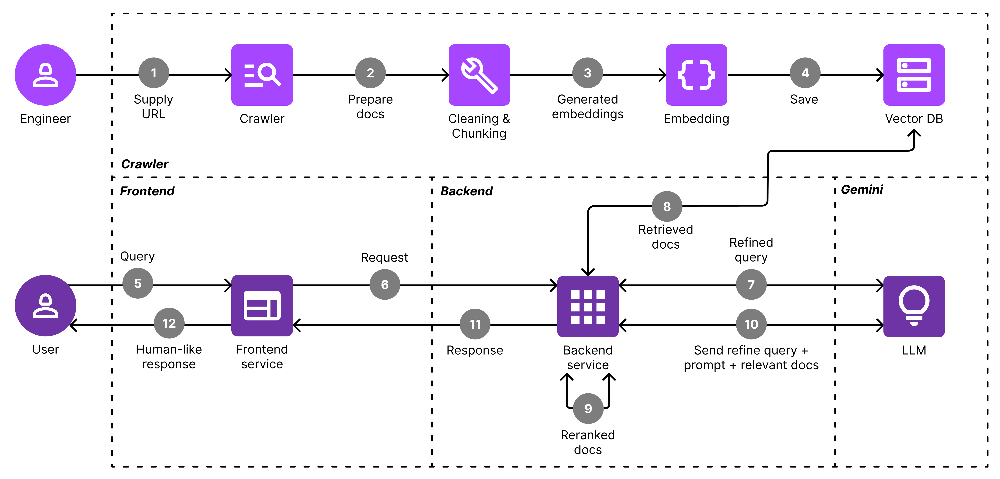

# code-compass

A Retrieval-Augmented-Generation (RAG) system that **scrape, index, and query programming documentation** (e.g. Matplotlib or NumPy docs). It allows users to ask precise, technical questions about the scraped documentation and receive **truth-based, cited answers with minimal hallucination**.

---

## Table of Contents
- [🧩 Overview](#🧩-overview)
- [⚙️ System Architecture](#⚙️-system-architecture)
- [🧠 Tech stack](#🧠-tech-stack)
- [🚀 Setup Guide](#🚀-setup-guide)
- [🔄 System Flow](#🔄-system-flow)
- [🕷️ Crawler](#🕷️-crawler)
- [🧮 Backend API](#🧮-backend-api)
- [💫 Embedding & LLM Configuration](#💫-embedding--llm-configuration)
- [💬 Frontend Overview](#💬-frontend-overview)
- [📊 RAGAS Evaluation Summary](#📊-ragas-evaluation-summary)
- [🧾Credits](#🧾-credits)

---

## 🧩 Overview
**code-compass** connects multiple components into a cohesive pipeline:
1. **Crawler** – Scrapes documentation websites, converts HTML → Markdown, cleans artifacts, and chunks content for embedding.  
2. **Vector Database** – Stores semantic embeddings using Postgres + `pgvector`.  
3. **Backend (FastAPI)** – Handles user prompts, retrieves relevant chunks via similarity search, and queries an LLM to produce grounded answers.  
4. **Frontend (React)** – Provides a conversational interface where users can chat with the assistant and view citation links.  
5. **Deployment** – Fully containerized using Docker Compose.

---

## ⚙️ System Architecture


---

## 🧠 Tech Stack

| Component | Tech | Description |
|------------|------|-------------|
| **Backend** | Python, FastAPI, SQLAlchemy, Alembic | REST API & data layer |
| **Database** | PostgreSQL + `pgvector` | Stores embeddings for semantic retrieval |
| **Crawler** | Python + Scrapy + `html2text` | Fetches & preprocesses docs |
| **Embedding Model** | `BAAI/bge-base-en-v1.5` | Creates document and query embeddings |
| **Reranking Model** | `BAAI/bge-reranker-base` | Refines retrieved documents to select the most relevant chunks |
| **LLM Options** | Gemini 2.5 Flash Lite / Other models | Answers questions using retrieved context |
| **Frontend** | React + Vite + TypeScript | Chat interface |
| **Deployment** | Docker Compose | Unified environment setup |

--- 

## 🚀 Setup Guide

### 1. Clone the repository
```bash
git clone https://github.com/MeAkash77/CodeCompass-AI-Powered-Codebase-Intelligence-Platform.git
```

### 2. Environment configuration
Create `.env` file for backend, crawler, and frontend based on the provided `.env.example` file.

### 3. Start containers
```bash
docker compose up --build
```

### 4. Run database migrations
```bash
alembic upgrade head
```

### 5. Add documentation URLs
Modify the `urls.txt` file

### 6. Run the crawler
```bash
scrapy crawl doc_spider -a urls_file="./urls.txt" --loglevel=INFO
```

### 7. Open the app
Frontend: http://localhost:3001

Backend: http://localhost:8000

---

## 🔄 System Flow

1. Crawl phase
    * The Scrapy crawler fetches documentation pages from the URLs specified by the user.
    * Each page’s HTML is **cleaned and converted to Markdown** using `html2text`, ensuring readability and consistent formatting.
    * During processing, each subsection (the parent) is **split into child chunks** for better retrieval performance.
    * The resulting parent–child structure ensures that both prose and code snippets are preserved with context, improving retrieval accuracy.
    * Each chunk is **embedded into a high-dimensional vector** using the `BAAI/bge-base-en-v1.5` model.
    * The resulting text chunks, metadata, and embeddings are **stored in a PostgreSQL database** with the `pgvector` extension, enabling fast vector similarity search.

2. Question phase
    * The user sends a prompt to `/ask` endpoint.
    * The query is refined using LLM.
    * The backend embeds the refined query using `BAAI/bge-base-en-v1.5`.
    * It performs a **similarity search** against stored document chunks in `pgvector`.
    * Retrieved parent chunks are reranked with the `BAAI/bge-reranker-base` model to select the most relevant ones.
    * Previous conversation history (if any) is summarized to provide additional context.
    * A structured, context-aware prompt is then built for the LLM, combining:
        - Style hint based on query
        - Conversation summary
        - Top-ranked document content
        - The user’s question and refine query
    * The LLM generates a **fact-grounded answer with citations**.
    * The API responds with the answer, citations, and an associated session identifier.

3. Conversation persistence
    * The backend includes a unique session identifier in the response header:
    `X-Session-Id`
    * The frontend captures and stores this value in `localStorage`.
    * All subsequent `/ask` requests reuse this `X-Session-Id`, allowing the backend to maintain conversation context across multiple questions.

---

## 🕷️ Crawler
Command:
```bash
scrapy crawl doc_spider -a urls_file="./urls.txt" --loglevel=INFO
```
### Crawler pipeline
1. Fetch documentation pages from the user-provided URLs using Scrapy.
2. Clean HTML content and convert relative links to absolute URLs for consistent referencing.
3. Extract structured `DocItem` objects with the following schema:
`{ title, section, subsection, content, url, metadata }`
4. Each page’s HTML is **cleaned and converted to Markdown** using `html2text`, ensuring readability and consistent formatting.
5. During processing, each subsection (parent) is **split into child chunks** for improved retrieval performance:
    * **Code blocks** are treated as standalone chunks to preserve formatting, syntax, and context.
    * **Text blocks** are recursively split into smaller, semantically coherent chunks using `RecursiveCharacterTextSplitter` (chunk size = 800, overlap = 100).
6. Each chunk is **embedded into a high-dimensional vector** using the `BAAI/bge-base-en-v1.5` model to capture its meaning.
7. Store all child chunks, parent chunks, metadata, and embeddings in a **PostgreSQL database** with `pgvector` extension.

--- 

## 🧮 Backend API

### Headers
* `X-Session-Id`: Session identifier for conversation continuity. If missing, backend generates one and returns it in response headers.

### Endpoints
`POST /ask`

Ask a question based on indexed documentation.

**Request**
```bash
{
  "prompt": "How do I plot multiple y axes in Matplotlib?",
  "max_token": 8192
}
```

Behavior:
1. Refine the query using LLM (configurable via `.env`), either Gemini 2.5 Flash Lite or other models.
1. Embed the query using `BAAI/bge-base-en-v1.5` to capture its semantic meaning.
3. Retrieve the top-k similar document chunks from the `pgvector` database via cosine similarity.
4. Rerank the retrieved chunks using the `BAAI/bge-reranker-base` model to identify the most relevant top-n results.
2. Load and summarize previous conversation (if any) using the stored session context to maintain continuity.
5. Construct a structured prompt for the LLM containing:
    * System instructions (e.g., ensure factual accuracy, use citations).
    * Style hint based on query
    * The summarized conversation context.
    * The top-ranked retrieved document chunks.
    * The user’s current question and refined query.
6. Call the selected LLM to generate a contextually grounded answer.
7. Return the LLM-generated answer along with structured citations referencing the original source URLs.

`GET /conversations`

Returns the list of all previous conversation exchanges associated with the current `X-Session-Id`.
Used by the frontend to restore chat history and maintain context across sessions.

--- 

## 💫 Embedding & LLM Configuration

| Setting             | Description                                                                           |
| ------------------- | ------------------------------------------------------------------------------------- |
| **Embedding model** | `BAAI/bge-base-en-v1.5`                  |
| **Vector DB**       | Postgres + `pgvector`, similarity = cosine distance.                                  |
| **LLM models**      | Configurable via `.env`: Gemini 2.5 Flash Lite or other models. |
| **Token limits**    | Token limits are applied when sending prompts for query refinement and answer generation.                 |


Example `.env` snippet:
```bash
MODEL_PROVIDER=gemini
LLAMA_MODEL=models/microsoft_Phi-4-mini-instruct-Q4_K_M.gguf
GEMINI_MODEL=gemini-2.5-flash-lite
GEMINI_API_KEY=
```

---

## 💬 Frontend Overview
* Built using React + Vite + TypeScript.
* Provides an interactive chat interface.
* Displays assistant answers with clickable citation links.
* Automatically manages `X-Session-Id` for persistent conversation.

---

## 📊 RAGAS Evaluation Summary

Evaluation was performed using the **RAGAS** framework to measure the quality of **retrieval** and **generation**.

| **Metric** | **Mean** | **Median** | **Description** |
|-------------|-----------|-------------|------------------|
| **Faithfulness** | `0.780` | `0.724` | Indicates how accurately the generated answers reflect the retrieved documents. A higher score means fewer hallucinations and better factual grounding. |
| **Context Precision** | `0.616` | `0.583` | Measures the proportion of retrieved documents that are relevant to the question. High precision implies cleaner, more focused retrieval. |
| **Context Recall** | `0.641` | `0.666` | Reflects how much of the relevant context was successfully retrieved. High recall ensures completeness of documents. |
| **Answer Relevancy** | `0.625` | `0.833` | Evaluates how well the final answer addresses the user’s query directly and coherently. |

**Number of evaluated queries:** 10  

* **Faithfulness** (`0.780` mean) is solid, showing that the LLM produces grounded answers with minimal hallucination.  
* **Context Precision** (`0.616` mean) and **Context Recall** (`0.641` mean) are closely aligned, indicating a **balanced retriever** that fetches enough relevant documents without excessive noise.  
* The **high median for Answer Relevancy** (`0.833`) compared to its mean (`0.625`) suggests **inconsistent query difficulty**, some answers are precise, while others were limited by sparse context or less informative chunks.  
* Given the evaluation was conducted on **limited hardware** using a **compact embedding model (`BAAI/bge-base-en-v1.5`)**, the overall performance is **decent** for a lightweight RAG system. 

---

## 🧾 Credits
Akash © 2025
